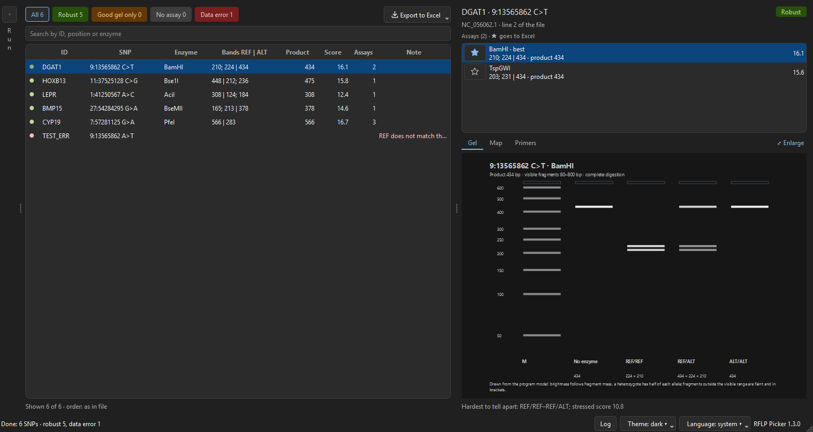
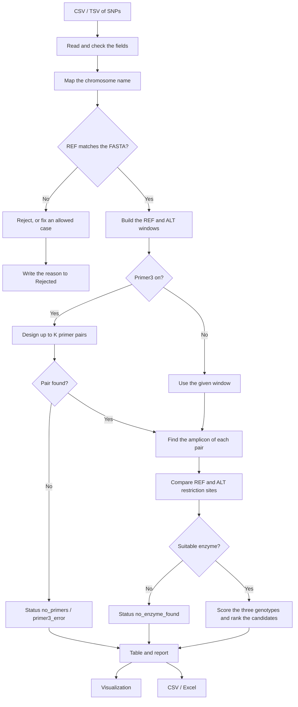

# RFLP Picker 1.3

English | [Русский](README.ru.md)



RFLP Picker is a desktop program for PCR-RFLP (CAPS) genotyping of SNPs. From a
list of SNPs and a reference genome it designs Primer3 primer pairs, finds
restriction enzymes that tell the three genotypes apart and shows the expected
bands on a virtual gel. The program compares REF and ALT on the reference FASTA,
reports fragment sizes and draws a map of the amplicon.

## What's new in 1.3

A new three-column window: launch, SNP list and the details of the chosen SNP —
see [Working with the window](#working-with-the-window). One row for each SNP of
the input file, status filters, assay choice with a star, the gel right in the
window, the Excel sheets “Summary” and “Primers”, SNP IDs from the input file,
light and dark themes. The interface is available in English and Russian: the
language follows the system and can be changed with the “Language” switch (see
[Interface language](#interface-language)). The analysis itself has not changed.
The list of changes is in the [CHANGELOG](CHANGELOG.md) (in Russian).

## What's new in 1.2

The changes are based on a check of version 1.1.0 against published assays.
Details are in the [algorithm description](docs/assay_design.md#отбор-и-проверки-с-версии-12)
(in Russian); the list of changes is in the [CHANGELOG](CHANGELOG.md) (in Russian).

- The analysis is 7–10 times faster with the same results; command line `rflp_cli.py`.
- Isoschizomers are grouped into one row; only commercially available enzymes by default.
- The SNP is kept at least 100 bp from the amplicon ends, so the diagnostic fragment stays visible.
- Assays where a primer itself contains the enzyme site are excluded.
- Soft-masked FASTA repeats are kept off primer 3′ ends.
- Known variants from a VCF: primers avoid them; assays where nearby variants
  change the cuts are flagged and excluded.
- dCAPS design (a primer with a mismatch) when there is no robust assay with a
  natural site.
- A “Virtual gel” tab in the visualization window.

The 1.2 settings are in the “Advanced” dialog of the “Run” panel (the “Checks”
group). The parameters of version 1.1.0 are restored with the “As in v1.1.0”
button there, or with `--preset v1.1` on the command line.

## Joint design of primers and enzyme

By default the program checks up to **10 Primer3 pairs per SNP**, scores how well
**REF/REF, REF/ALT and ALT/ALT** can be told apart and reports up to 10 best
combinations. The “Advanced” dialog sets the number of pairs, the number of
results (0: all), the absolute and relative gel resolution and the resolution
stress factor. The default model parameters (10 bp, 3%, ×1.5) are screening
assumptions; compare them with the conditions of your own experiment.

The ranking uses a **maximin score**: the assay whose hardest genotype pair is
best separated under the stressed resolution comes first. A score > 1 means the
genotypes are distinguishable in the model. `robust`: they stay distinguishable
under stress; `nominal_only`: only at the nominal resolution. This is not a
probability of successful genotyping.

The chosen row shows the expected bands of the three genotypes and an
explanation. All scores, parameters and the pair number are written to the
export. To compare with the older approach, turn off the joint design of primers
and enzyme.

Formulas, ranking rules, limitations and a reproducible comparison of the modes:
[algorithm description](docs/assay_design.md) (in Russian).

## How it works

RFLP Picker takes a list of SNPs, checks them against the reference genome and
looks for restriction enzymes that give distinguishable fragment patterns for
the REF and ALT alleles. With Primer3 on, it also designs a PCR primer pair for a
suitable region. For each position the result shows the enzyme, the recognition
site, the fragment sizes, the primer parameters and a plain processing status.

Processing of one position:



Normalization keeps wrong coordinates and alleles out of the analysis. It does
not replace the checks: even with normalization off, the program still checks
that the chromosome exists, that the position is in range and that REF matches
the reference.

## Running from source

Python 3.11 or newer is required. In PowerShell, from this folder, run:

```powershell
python -m pip install -r requirements.txt
```

Then start the program:

```powershell
python qtprimer3_vis.py
```

The appearance follows the Windows 11 theme, including a switch between light
and dark while the program is running.

## Command line

`rflp_cli.py` runs the same analysis without the window, for batch runs and
scripts. The result is saved as CSV or Excel (by the extension of `--out`); like
the export from the window, Excel gets the Run and Rejected sheets.

```powershell
python rflp_cli.py --fasta genome.fa --variants snps.tsv --names names.txt --out results.xlsx
python rflp_cli.py --help
```

By default the settings are the same as in the program window
(`--preset recommended`). `--preset v1.1` reproduces the parameters and results
of version 1.1.0. Any parameter can be overridden, for example
`--pairs 20 --top 0 --prod-min 150 --prod-max 1000`. Exit codes: 0 — success,
2 — parameter error, 130 — interrupted (Ctrl+C).

The help, the messages and the Summary and Primers sheets follow the system
language; `--lang en` or `--lang ru` sets it explicitly.

## Windows release

Download the release archive and run `RFLP-Picker.exe`. Python is not needed on
the computer. The reference FASTA is not in the archive because of its size;
choose it in the “Genome” field. The `names/` folder in the archive holds a
ready chromosome name mapping for the genome used in the examples.

The release archive is in the Releases section on GitHub. To rebuild the EXE
from source you need Python 3.13 and the packages from `requirements.txt`; run
`.\build_windows.ps1`. The result appears in `dist/RFLP-Picker/`.

The archive comes without a README: the instructions are in this file on GitHub.
The `_internal` and `names` folders must stay next to the EXE.

## Data

In the window, choose:

- a variants file (CSV, TSV or TXT) with the columns `chrom`, `pos`, `ref`, `alt`;
- a reference genome FASTA: the “Genome” list holds recent genomes and FASTA files
  from the `genoms/` folder next to the program, “Choose a file…” opens any other;
- if needed, a chromosome name mapping file: the program takes
  `names/<genome name>.txt` by itself, another file is chosen with the “change” link.

Single-base SNPs are supported: one character in `REF` and one in `ALT`, only
`A`, `C`, `G`, `T`. Positions in the file start at 1. Quoted CSV and UTF-8 with
BOM are supported. Invalid lines are saved to `results/normalize/*.rejected.tsv`
with the original line number and the reason when saving of normalization is on;
in any case the reasons are shown in the log and in the SNP list.

## Parameters

The flank is the number of bases on each side of the SNP. In the joint mode the
fragment range sets the limits of band visibility: fragments outside the range
are hidden in the model but kept in the full fragment lists. In the single pair
or window mode every fragment must fall into the range.
The Δ threshold applies to the symmetric Hausdorff distance between the visible
REF and ALT sizes: the largest distance to the nearest size of the other allele.
It applies to both gain/loss and shift. The joint search also requires all
three genotypes to differ in the presence of bands.

With Primer3 on, the program searches for primer pairs within the given product
size and Tm range. When no pair is found, the line gets the status “no primers”
and gives no false enzyme candidates. With Primer3 off, the search runs over the
whole window and is marked “window search”.

dCAPS assays (a mismatch primer that creates the enzyme site in one allele) are
designed with their own settings — the “dCAPS” group of the “Advanced” dialog:
Tm of both primers up to 70 °C, product 120–300 bp, Δ threshold 20 bp. A longer
primer moves the cut away from the product end, and on a short product a ~20 bp
difference is easy to see on a gel. Ordinary assays are not affected. By default
dCAPS is tried only for SNPs without a robust assay with a natural site; the
“For every SNP” mode of the “Run” panel always offers it, and then dCAPS assays
are ranked together with ordinary ones. On the command line:
`--dcaps-tm-max`, `--dcaps-prod-min`, `--dcaps-prod-max`, `--dcaps-delta`.

Checking the coordinates and that `REF` matches the FASTA is always on. The
option to skip normalization turns off only the automatic REF/ALT swap.

## Working with the window

The window has three columns (see the screenshot at the top of this file).

1. **Run.** SNP file, genome, an optional VCF of known variants, product size,
   Tm, enzyme suppliers and the dCAPS mode. The other parameters are under the
   “Advanced…” link. The program remembers files and parameters between
   sessions. After a run the panel collapses; “ and ” collapse and expand it.
2. **SNP list.** One row for each SNP of the file, in file order. The counters
   above the list — “Robust”, “Good gel only”, “No assay”, “Data error” — work
   as filters; the search looks at the ID, the position and the enzyme. The
   “Note” column holds warnings and hints on what to change when no assay was
   found. More columns are added with a right click on the header.
3. **Details of the chosen SNP.** All assays of the SNP; the star marks the
   assay that goes to Excel (the best one by default). The “Gel”, “Map” and
   “Primers” tabs: the primer card copies “name ⇥ sequence” lines for an oligo
   order form. “⤢ Enlarge” opens the map with sequences and PNG/SVG export.

When the input file has an `id` column (or `name`, `snp_id`, `rsid`), its values
appear in the list, in Excel and in the primer names (`DGAT1_F`, `DGAT1_R`).

The theme follows Windows; the “Theme” switch in the status bar selects light
or dark by hand.

### Interface language

When Windows uses Russian, the program opens in Russian; with any other
language it opens in English. The “Language” switch in the status bar selects
the language by hand (“System”, “Русский”, “English”); a new language applies
after the program is restarted. The window, the notes, the Excel sheets
“Summary” and “Primers” and the log are translated. The technical sheets
`Results`, `Run` and `Rejected` are the same in both languages; the `reason`
column of `Results` and the `details` column of `Rejected` always hold the
original text of the analysis in Russian.

## Results and export

The “Export to Excel ▾” button saves all SNPs or only the shown ones (after the
filter and the search) to the `results/` folder. Excel sheets:

- “Summary” — one row per SNP for the chosen assay: status, enzyme, primers, Tm,
  product, bands of the three genotypes, score, note;
- “Primers” — names and sequences for ordering oligos;
- `Results` — all assays of all SNPs, as in 1.2, plus the `snp_id` and
  `selected` columns;
- `Run` and `Rejected` — run parameters and rejected lines.

“CSV: all assays” saves the contents of the `Results` sheet as UTF-8 with BOM.

## Project structure

`qtprimer3_vis.py` — the main window; `launch_panel.py`, `snp_list.py`,
`details_panel.py` — its three columns; `snp_summary.py` — the per-SNP summary
for the window, Excel and the command line (no Qt); `palette.py`, `theme.py`,
`icons.py` — colors, theme and icons; `app_settings.py` — remembered settings;
`i18n.py` and `translations_en.py` — the interface language and the English
texts; `rflp_cli.py` — the command line; `rflp_core.py` — reading,
normalization and the analysis; `reporting.py` — safe CSV/XLSX export;
`result_model.py` — titles of the core columns; `resources_rc.py` — Qt
resources; `genoms/` and `names/` — input data.
`assay_scoring.py` — the band model and maximin ranking;
`benchmark_design.py` — comparison of the modes with data checksums;
`visualization.py` — the amplicon map and the virtual gel with export;
`tools/regression.py` — comparison of the results of two program versions;
`tools/gui_screenshots.py` — window screenshots in a chosen language, both
themes and three sizes; `examples/` — a clearly synthetic example for a quick check.

## Testing

Run the tests:

```powershell
python -m unittest discover -s tests -v
python -m py_compile qtprimer3_vis.py rflp_core.py reporting.py result_model.py
```

Window screenshots for a manual check (1920×1040, 1536×816 and 1280×680, light
and dark themes; `--lang ru` for the Russian interface):

```powershell
python tools\gui_screenshots.py --lang en --fasta genome.fa --variants variants.tsv --out shots
```

Changes that must not alter the results (refactoring, speed-ups) are compared
with the v1.1.0 release: each version runs in its own process, and the header,
the rows and the report are compared. `same` — byte-identical, `extended` — only
new columns and report fields were added and every v1.1.0 value is unchanged;
any other difference is an error.

```powershell
git worktree add ..\rflp-v1.1.0 42ad9e5
python tools\regression.py --baseline ..\rflp-v1.1.0 --work ..\regression `
  --dataset sheep=genome.fa,variants.tsv --random 100 --jobs 8
```
