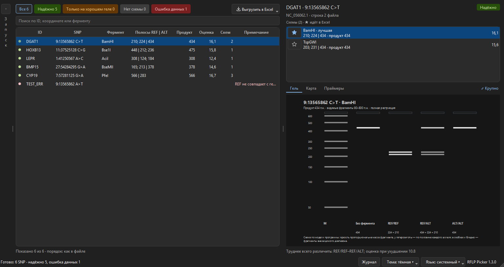
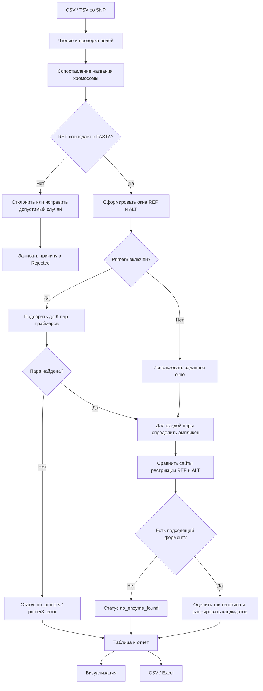

# RFLP Picker 1.3

[English](README.md) | Русский



RFLP Picker — настольная программа для ПЦР-ПДРФ (CAPS) генотипирования SNP: по
списку SNP и референсному геному она подбирает пары праймеров Primer3 и
рестриктазы, которые различают три генотипа, и показывает ожидаемые полосы на
виртуальном геле. Программа сравнивает REF и ALT на референсном FASTA,
показывает размеры фрагментов и позволяет открыть схему ампликона.

## Что нового в 1.3

Новое окно в три колонки: запуск, список SNP и детали выбранного SNP —
см. [Работа с окном](#работа-с-окном). Одна строка на каждый SNP из файла,
статусы-фильтры, выбор схемы звёздочкой, гель прямо в окне, листы Excel
«Сводка» и «Праймеры», ID SNP из входного файла, светлая и тёмная темы.
Интерфейс на русском и английском: язык берётся из системы, его можно
сменить переключателем «Язык» (см. [Язык интерфейса](#язык-интерфейса)).
Расчёт не изменился. Список изменений — в [CHANGELOG](CHANGELOG.md).

## Что нового в 1.2

Изменения основаны на проверке версии 1.1.0 на опубликованных анализах.
Подробности — в [описании алгоритма](docs/assay_design.md#отбор-и-проверки-с-версии-12),
список изменений — в [CHANGELOG](CHANGELOG.md).

- Расчёт в 7–10 раз быстрее с теми же результатами; командная строка `rflp_cli.py`.
- Изошизомеры объединяются в одну строку; по умолчанию только продаваемые ферменты.
- SNP не ближе 100 п.н. к концам ампликона: диагностический фрагмент остаётся видимым.
- Схемы, где праймер сам содержит сайт фермента, исключаются.
- Повторы soft-mask FASTA не попадают на 3′-концы праймеров.
- Известные варианты из VCF: праймеры их избегают, схемы, где соседние замены
  меняют разрезы, отмечаются и исключаются.
- Проектирование dCAPS (праймер с несовпадением), если нет надёжной схемы
  с природным сайтом.
- Вкладка «Виртуальный гель» в окне визуализации.

Настройки v1.2 собраны в окне «Дополнительно» панели «Запуск» (группа «Проверки»).
Параметры версии 1.1.0 воспроизводятся кнопкой «Как в v1.1.0» там же
или `--preset v1.1` в командной строке.

## Совместный подбор праймеров и фермента

По умолчанию программа проверяет до **10 пар Primer3 на SNP**, оценивает
различимость **REF/REF, REF/ALT и ALT/ALT** и выдаёт до 10 лучших сочетаний.
В правой панели можно изменить число пар, число результатов (0 — все),
абсолютное и относительное разрешение геля и коэффициент его ухудшения.
Исходные параметры модели (10 п.н., 3%, ×1.5) — предположения для скрининга,
их нужно сопоставить с условиями своего эксперимента.

Используется **максиминная оценка**: выше располагается схема с лучшей
различимостью самой трудной пары генотипов при ухудшенном разрешении.
Оценка > 1 означает различимость в модели. `robust` — различимость сохраняется
при ухудшении; `nominal_only` — только при исходном разрешении.
Это не вероятность успешного генотипирования.

Выбранная строка показывает ожидаемые полосы трёх генотипов и пояснение.
Все оценки, параметры и номер пары сохраняются в экспорт. Для сравнения со
старым подходом отключите «Подбирать праймеры и фермент совместно».

Формулы, правила ранжирования, ограничения и воспроизводимое сравнение режимов:
[Описание алгоритма](docs/assay_design.md).

## Суть программы

RFLP Picker получает список SNP, проверяет их по референсному геному и ищет
рестриктазы, которые дают различимый рисунок фрагментов для аллелей REF и ALT.
Если включён Primer3, для подходящего участка дополнительно подбирается пара
PCR-праймеров. В результате для каждой позиции видны фермент, сайт узнавания,
размеры фрагментов, параметры праймеров и понятный статус обработки.

Схема обработки одной позиции:



Нормализация нужна для того, чтобы не анализировать ошибочные координаты и
аллели. Она не заменяет проверку: даже при отключённой нормализации программа
всё равно контролирует наличие хромосомы, диапазон координат и соответствие
REF референсу.

## Запуск из исходников

Требуется Python 3.11 или новее. В PowerShell из этой папки выполните:

```powershell
python -m pip install -r requirements.txt
```

Затем запустите приложение:

```powershell
python qtprimer3_vis.py
```

Оформление автоматически подстраивается под тему Windows 11. Переключение
светлой и тёмной темы во время работы также обновляет цвета интерфейса.

## Командная строка

`rflp_cli.py` выполняет тот же анализ без окна — для пакетных запусков и
скриптов. Результат сохраняется в CSV или Excel (по расширению `--out`);
в Excel, как и при экспорте из окна, есть листы Run и Rejected.

```powershell
python rflp_cli.py --fasta genome.fa --variants snps.tsv --names names.txt --out results.xlsx
python rflp_cli.py --help
```

По умолчанию используются те же настройки, что в окне программы
(`--preset recommended`). `--preset v1.1` воспроизводит параметры и
результаты версии 1.1.0. Любой параметр можно переопределить, например
`--pairs 20 --top 0 --prod-min 150 --prod-max 1000`. Код возврата: 0 — успех,
2 — ошибка параметров, 130 — прервано (Ctrl+C).

Справка, сообщения и листы «Сводка» и «Праймеры» выводятся на языке системы;
`--lang ru` или `--lang en` задаёт язык явно.

## Запуск готовой версии Windows

Скачайте архив релиза и запустите `RFLP-Picker.exe`. Python на
компьютере для этого не требуется. Референсный FASTA не входит в архив из-за
размера; выберите его в поле «Геном». Папка `names/` в архиве содержит
готовое соответствие названий хромосом для используемого генома.

Готовый архив релиза находится в разделе Releases на GitHub. Для пересборки EXE
из исходников требуется Python 3.13 и зависимости из `requirements.txt`;
выполните `.\build_windows.ps1`. Результат появится в `dist/RFLP-Picker/`.

Архив распространяется без README: инструкция находится в этом файле на
GitHub, а рядом с EXE должны находиться папка `_internal` и каталог `names`.

## Данные

В окне выберите:

- файл вариантов CSV, TSV или TXT с колонками `chrom`, `pos`, `ref`, `alt`;
- референсный геном FASTA: в списке «Геном» — недавние геномы и файлы FASTA
  из папки `genoms/` рядом с программой, «Выбрать файл…» открывает любой другой;
- при необходимости — файл соответствий названий хромосом: программа сама берёт
  `names/<имя генома>.txt`, другой файл выбирается ссылкой «изменить».

Поддерживаются одиночные SNP: один символ в `REF` и один символ в `ALT`,
только `A`, `C`, `G`, `T`. Позиции в файле начинаются с 1. CSV с кавычками и
UTF-8 с BOM поддерживается. Некорректные строки сохраняются в
`results/normalize/*.rejected.tsv`, если включено сохранение нормализации, с
номером исходной строки и причиной; в любом случае причины видны в журнале.

Для проверки используйте собственный небольшой CSV/TSV-файл с вариантами.

## Параметры

Фланк задаёт число оснований по обе стороны SNP. В совместном режиме диапазон
фрагментов задаёт границы видимости полос: фрагменты вне диапазона скрываются
в модели, но сохраняются в исходных списках фрагментов. В режиме одной пары
или окна каждый фрагмент должен попадать в диапазон.
Порог Δ применяется к симметричному расстоянию Хаусдорфа между видимыми
длинами REF и ALT: максимуму расстояний до ближайшей длины другого аллеля.
Он применяется и к gain/loss, и к shift. Совместный поиск дополнительно
требует различимости всех трёх генотипов по присутствию полос.

При включённом Primer3 программа ищет пары праймеров в заданном диапазоне
размера продукта и Tm. Если пара не найдена, строка получает статус
«Праймеры не найдены» и не выдаёт ложные ферментные кандидаты. Если Primer3
выключен, поиск идёт по полному окну и помечается «Поиск по окну».

Проверка координат и соответствия `REF` FASTA обязательна всегда. Опция
пропуска нормализации отключает только автоматическую перестановку REF/ALT.

## Работа с окном

Окно состоит из трёх колонок (снимок — в начале этого файла).

1. **Запуск.** Файл SNP, геном, при необходимости VCF известных вариантов,
   длина продукта, Tm, поставщики ферментов и режим dCAPS. Остальные параметры —
   по ссылке «Дополнительно…». Программа запоминает файлы и параметры
   между запусками. После расчёта панель сворачивается; « и » сворачивают
   и разворачивают её.
2. **Список SNP.** Одна строка на каждый SNP из файла, в порядке файла.
   Счётчики над списком — «Надёжно», «Только на хорошем геле», «Нет схемы»,
   «Ошибка данных» — работают как фильтры; поиск ищет по ID, координате
   и ферменту. В «Примечании» — предупреждения и подсказки, что изменить,
   если схема не найдена. Дополнительные столбцы включаются правым щелчком
   по заголовку.
3. **Детали выбранного SNP.** Все схемы SNP; звёздочка отмечает схему,
   которая пойдёт в Excel (по умолчанию лучшая). Вкладки «Гель», «Карта»
   и «Праймеры»: карточка праймеров копирует строки «имя ⇥ последовательность»
   для бланка заказа. «⤢ Крупно» открывает карту с последовательностями
   и сохранением PNG/SVG.

Если во входном файле есть столбец `id` (или `name`, `snp_id`, `rsid`),
его значения видны в списке, в Excel и в именах праймеров (`DGAT1_F`, `DGAT1_R`).

Тема берётся из Windows; переключатель «Тема» в строке состояния позволяет
выбрать светлую или тёмную вручную.

### Язык интерфейса

Если язык Windows русский, программа открывается на русском, при любом другом —
на английском. Переключатель «Язык» в строке состояния позволяет выбрать язык
вручную («Системный», «Русский», «English»); новый язык применяется после
перезапуска программы. Переводятся окно, примечания, листы Excel «Сводка» и
«Праймеры» и журнал. Технические листы `Results`, `Run` и `Rejected` одинаковы
на обоих языках; столбец `reason` листа `Results` всегда содержит исходный текст
расчёта на русском.

## Результаты и экспорт

Кнопка «Выгрузить в Excel ▾» сохраняет все SNP или только показанные
(с учётом фильтра и поиска) в папку `results/`. Листы Excel:

- «Сводка» — одна строка на SNP по выбранной схеме: статус, фермент, праймеры,
  Tm, продукт, полосы трёх генотипов, оценка, примечание;
- «Праймеры» — имена и последовательности для заказа синтеза;
- `Results` — все схемы всех SNP, как в 1.2, плюс столбцы `snp_id` и `selected`;
- `Run` и `Rejected` — параметры запуска и отклонённые строки.

«CSV: все схемы» сохраняет содержимое листа `Results` в UTF-8 с BOM.

## Структура проекта

`qtprimer3_vis.py` — главное окно; `launch_panel.py`, `snp_list.py`,
`details_panel.py` — его три колонки; `snp_summary.py` — сводка по SNP
для окна, Excel и командной строки (без Qt); `palette.py`, `theme.py`,
`icons.py` — цвета, тема и иконки; `app_settings.py` — запоминание настроек;
`rflp_cli.py` — командная строка; `rflp_core.py` — чтение,
нормализация и расчёт; `reporting.py` — безопасный CSV/XLSX экспорт;
`result_model.py` — названия столбцов ядра; `i18n.py` и `translations_en.py` —
язык интерфейса и английские тексты;
`resources_rc.py` — ресурсы Qt; `genoms/` и `names/` — исходные данные.
`assay_scoring.py` — модель полос и максиминное ранжирование;
`benchmark_design.py` — сравнение режимов с контрольными суммами данных;
`visualization.py` — окно схемы ампликона с экспортом;
`tools/regression.py` — сравнение результатов двух версий программы;
`tools/gui_screenshots.py` — снимки окна на выбранном языке в обеих темах и трёх размерах;
`examples/` — явно синтетический пример для проверки работоспособности.

## Проверка

Запуск тестов:

```powershell
python -m unittest discover -s tests -v
python -m py_compile qtprimer3_vis.py rflp_core.py reporting.py result_model.py
```

Снимки окна для ручной проверки (1920×1040, 1536×816 и 1280×680, светлая
и тёмная темы; `--lang en` — английский интерфейс):

```powershell
python tools\gui_screenshots.py --lang ru --fasta genome.fa --variants variants.tsv --out shots
```

Изменения, которые не должны менять результаты (рефакторинг, ускорение),
сверяются с выпуском v1.1.0: каждая версия запускается в отдельном процессе,
а заголовок, строки и отчёт сравниваются. `same` — побайтное совпадение,
`extended` — добавлены только новые столбцы и поля отчёта, а все значения
v1.1.0 не изменились; любое другое отличие — ошибка.

```powershell
git worktree add ..\rflp-v1.1.0 42ad9e5
python tools\regression.py --baseline ..\rflp-v1.1.0 --work ..\regression `
  --dataset sheep=genome.fa,variants.tsv --random 100 --jobs 8
```
