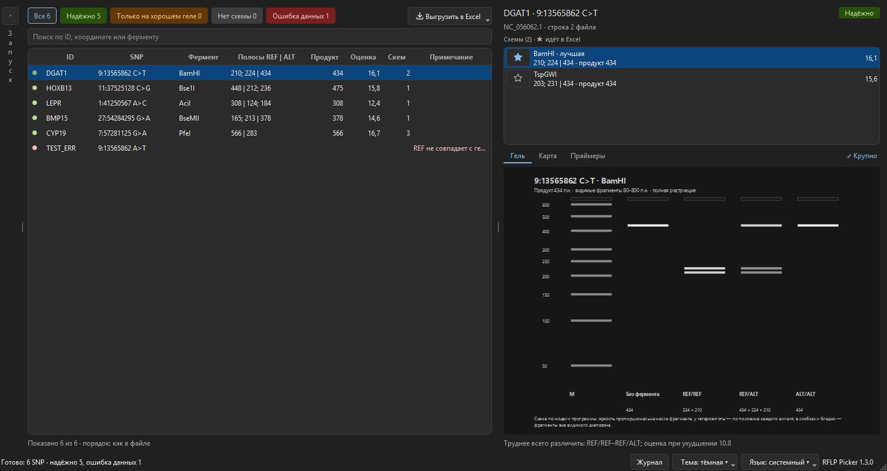
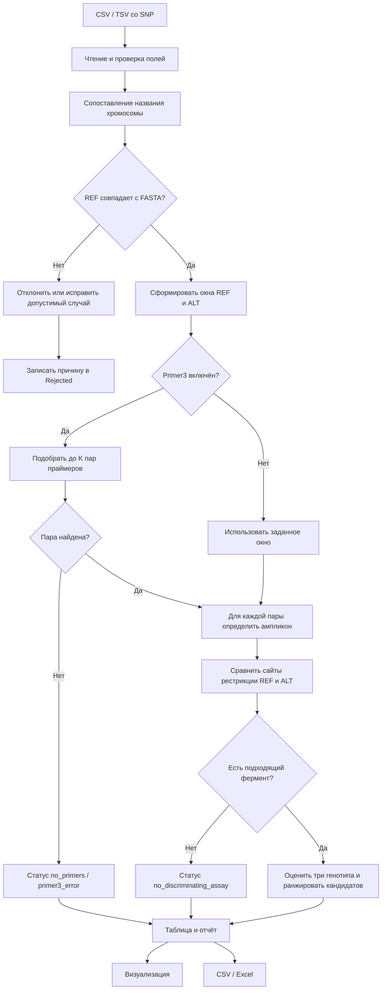

# RFLP Picker 1.5

[English](README.md) | Русский



RFLP Picker — настольная программа для ПЦР-ПДРФ (CAPS) генотипирования SNP: по
списку SNP и референсному геному она подбирает пары праймеров Primer3 и
рестриктазы, которые различают три генотипа, и показывает ожидаемые полосы на
виртуальном геле. Программа сравнивает REF и ALT на референсном FASTA,
показывает размеры фрагментов и позволяет открыть схему ампликона.

## Что нового в 1.5

- Эталонные геномы скачиваются с NCBI из программы: пункт «Скачать геном…» в
  списке «Геном» — см. [Данные](#данные).
- Лабораторные листы PDF, одна страница A4 на SNP: фермент, праймеры, полосы,
  гель, карта и поля для записей от руки — см.
  [Результаты и экспорт](#результаты-и-экспорт).
- Готовая сборка для Linux рядом со сборкой для Windows — см.
  [Запуск готовой версии Linux](#запуск-готовой-версии-linux).
- Режим одной пары праймеров, кнопка «Как в v1.1.0» и ключ `--preset` убраны;
  статью воспроизводит сам выпуск 1.1.0.
- Поиск по окну (без Primer3) оценивается по тем же правилам, что и подбор с
  праймерами, поэтому его результаты отличаются от 1.4.

Подбор с Primer3 даёт те же схемы, что в 1.4. Список изменений — в
[CHANGELOG](CHANGELOG.md).

## Что нового в 1.4

- У схем dCAPS (праймер с несовпадением) свои настройки: Tm до 70 °C, продукт
  120–300 п.н., порог Δ 20 п.н. — см. [Параметры](#параметры).
- Геномы с контигами `chr1`, `chr2`, … работают без файла соответствий
  названий хромосом.
- Подбор праймеров работает в Linux и macOS при системной локали с десятичной
  запятой (русская, немецкая и др.).
- Командная строка: о несуществующей папке результата сообщается до расчёта;
  нечитаемый FASTA даёт сообщение и код возврата 1 вместо трассировки.
- На листе `Rejected` у каждого отклонённого варианта указан номер строки
  входного файла.
- Программа распространяется на условиях [GPL версии 3 или более поздней](#лицензия).

Схемы с природным сайтом те же, что в 1.3, кроме случая, когда в VCF известных
вариантов контиги названы иначе, чем в геноме (`chr1` и `1`): раньше такой VCF
не учитывался, теперь учитывается. Список изменений — в
[CHANGELOG](CHANGELOG.md).

## Что нового в 1.3

Новое окно в три колонки: запуск, список SNP и детали выбранного SNP —
см. [Работа с окном](#работа-с-окном). Одна строка на каждый SNP из файла,
статусы-фильтры, выбор схемы звёздочкой, гель прямо в окне, листы Excel
«Сводка» и «Праймеры», ID SNP из входного файла, светлая и тёмная темы.
Интерфейс на русском и английском: язык берётся из системы, его можно
сменить переключателем «Язык» (см. [Язык интерфейса](#язык-интерфейса)).
Расчёт не изменился. Список изменений — в [CHANGELOG](CHANGELOG.md).

## Что нового в 1.2

Изменения основаны на проверке версии 1.1.0 на опубликованных анализах.
Подробности — в [описании алгоритма](docs/assay_design.md#отбор-и-проверки-с-версии-12),
список изменений — в [CHANGELOG](CHANGELOG.md).

- Расчёт в 7–10 раз быстрее с теми же результатами; командная строка `rflp_cli.py`.
- Изошизомеры объединяются в одну строку; по умолчанию только продаваемые ферменты.
- SNP не ближе 100 п.н. к концам ампликона: диагностический фрагмент остаётся видимым.
- Схемы, где праймер сам содержит сайт фермента, исключаются.
- Повторы soft-mask FASTA не попадают на 3′-концы праймеров.
- Известные варианты из VCF: праймеры их избегают, схемы, где соседние замены
  меняют разрезы, отмечаются и исключаются.
- Проектирование dCAPS (праймер с несовпадением), если нет надёжной схемы
  с природным сайтом.
- Вкладка «Виртуальный гель» в окне визуализации.

Настройки v1.2 собраны в окне «Дополнительно» панели «Запуск» (группа «Проверки»).

Статья описывает версию 1.1.0. Чтобы воспроизвести её результаты, используйте
сам [выпуск 1.1.0](https://github.com/adrobi/rflppicker/releases/tag/v1.1.0): в более новых версиях режима, повторяющего её, нет.

## Совместный подбор праймеров и фермента

По умолчанию программа проверяет до **10 пар Primer3 на SNP**, оценивает
различимость **REF/REF, REF/ALT и ALT/ALT** и выдаёт до 10 лучших сочетаний.
В окне «Дополнительно» панели «Запуск» можно изменить число пар, число результатов (0 — все),
абсолютное и относительное разрешение геля и коэффициент его ухудшения.
Исходные параметры модели (10 п.н., 3%, ×1.5) — предположения для скрининга,
их нужно сопоставить с условиями своего эксперимента.

Используется **максиминная оценка**: выше располагается схема с лучшей
различимостью самой трудной пары генотипов при ухудшенном разрешении.
Оценка > 1 означает различимость в модели. `robust` — различимость сохраняется
при ухудшении; `nominal_only` — только при исходном разрешении.
Это не вероятность успешного генотипирования.

Выбранная строка показывает ожидаемые полосы трёх генотипов и пояснение.
Все оценки, параметры и номер пары сохраняются в экспорт.

Формулы, правила ранжирования и ограничения:
[Описание алгоритма](docs/assay_design.md).

## Суть программы

RFLP Picker получает список SNP, проверяет их по референсному геному и ищет
рестриктазы, которые дают различимый рисунок фрагментов для аллелей REF и ALT.
Если включён Primer3, для подходящего участка дополнительно подбирается пара
PCR-праймеров. В результате для каждой позиции видны фермент, сайт узнавания,
размеры фрагментов, параметры праймеров и понятный статус обработки.

Схема обработки одной позиции:



Нормализация нужна для того, чтобы не анализировать ошибочные координаты и
аллели. Она не заменяет проверку: даже при отключённой нормализации программа
всё равно контролирует наличие хромосомы, диапазон координат и соответствие
REF референсу.

## Запуск из исходников

Требуется Python 3.11 или новее. В PowerShell из этой папки выполните:

```powershell
python -m pip install -r requirements.txt
```

Затем запустите приложение:

```powershell
python qtprimer3_vis.py
```

Оформление автоматически подстраивается под тему Windows 11. Переключение
светлой и тёмной темы во время работы также обновляет цвета интерфейса.

## Командная строка

`rflp_cli.py` выполняет тот же анализ без окна — для пакетных запусков и
скриптов. Результат сохраняется в CSV или Excel (по расширению `--out`);
в Excel, как и при экспорте из окна, есть листы Run и Rejected.

```powershell
python rflp_cli.py --fasta genome.fa --variants snps.tsv --names names.txt --out results.xlsx
python rflp_cli.py --help
```

По умолчанию используются те же настройки, что в окне программы. Любой
параметр можно переопределить, например
`--pairs 20 --top 0 --prod-min 150 --prod-max 1000`. Код возврата: 0 — успех,
1 — расчёт или сохранение не удались, 2 — ошибка параметров, 130 — прервано (Ctrl+C).

Справка, сообщения и листы «Сводка» и «Праймеры» выводятся на языке системы;
`--lang ru` или `--lang en` задаёт язык явно.

## Запуск готовой версии Windows

Скачайте архив релиза и запустите `RFLP-Picker.exe`. Python на
компьютере для этого не требуется. Референсный FASTA не входит в архив из-за
размера; выберите его в поле «Геном». Папка `names/` в архиве содержит
готовое соответствие названий хромосом для используемого генома.

Готовый архив релиза находится в разделе Releases на GitHub. Для пересборки EXE
из исходников требуется Python 3.13 и зависимости из `requirements-build.txt`;
выполните `.\build_windows.ps1`. Результат появится в `dist/RFLP-Picker/`.

Архив распространяется без README: инструкция находится в этом файле на
GitHub, а рядом с EXE должны находиться папка `_internal` и каталог `names`.

## Запуск готовой версии Linux

Скачайте `RFLP-Picker-…-linux-x86_64.tar.gz` из раздела Releases, распакуйте и
запустите `RFLP-Picker/RFLP-Picker`. Python не требуется. Архив собирается в
Ubuntu 22.04 и рассчитан на 64-битную систему того же возраста или новее
(glibc 2.35). Если окно не открывается, установите библиотеку Qt
`libxcb-cursor0` (`sudo apt install libxcb-cursor0`). Для пересборки выполните
`./build_linux.sh` с Python 3.13 и зависимостями из `requirements-build.txt`.

Оба архива собираются в GitHub Actions по тегу версии
(`.github/workflows/release.yml`).

## Данные

В окне выберите:

- файл вариантов CSV, TSV или TXT с колонками `chrom`, `pos`, `ref`, `alt`;
- референсный геном FASTA: в списке «Геном» — недавние геномы и файлы FASTA
  из папки `genoms/` рядом с программой, «Выбрать файл…» открывает любой другой;
- при необходимости — файл соответствий названий хромосом: программа сама берёт
  `names/<имя генома>.txt`, другой файл выбирается ссылкой «изменить».

Пункт «Скачать геном…» в списке «Геном» загружает эталонную сборку с FTP NCBI:
выберите одну из перечисленных сборок (овца, корова, коза, свинья, курица, рис,
пшеница, ячмень, сорго) или введите любой номер вида `GCF_016772045.1`.
Координаты в файле SNP должны относиться к той же сборке; для овцы в списке
есть и ARS-UI_Ramb_v3.0, и v2.0. Загрузку можно остановить, при повторе она
продолжится с того же места; файл сверяется с контрольной суммой NCBI,
распаковывается в `genoms/` и индексируется. Файл соответствий названий
хромосом `names/<сборка>.txt` создаётся по отчёту NCBI о сборке (существующий
файл не заменяется). Геном занимает на диске 0,4–15 ГБ. В командной строке:
`python rflp_cli.py --download-genome GCF_016772045.1`.

Поддерживаются одиночные SNP: один символ в `REF` и один символ в `ALT`,
только `A`, `C`, `G`, `T`. Позиции в файле начинаются с 1. CSV с кавычками и
UTF-8 с BOM поддерживается. Некорректные строки сохраняются в
`results/normalize/*.rejected.tsv`, если включено сохранение нормализации, с
номером исходной строки и причиной; в любом случае причины видны в журнале.

Для проверки используйте собственный небольшой CSV/TSV-файл с вариантами.

## Параметры

Фланк задаёт число оснований по обе стороны SNP. Диапазон фрагментов задаёт
границы видимости полос: фрагменты вне диапазона скрываются в модели, но
сохраняются в исходных списках фрагментов.
Порог Δ применяется к симметричному расстоянию Хаусдорфа между видимыми
длинами REF и ALT: максимуму расстояний до ближайшей длины другого аллеля.
Он применяется и к gain/loss, и к shift. Дополнительно требуется различимость
всех трёх генотипов по присутствию полос.

При включённом Primer3 программа ищет пары праймеров в заданном диапазоне
размера продукта и Tm. Если пара не найдена, строка получает статус
«Праймеры не найдены» и не выдаёт ложные ферментные кандидаты. Если Primer3
выключен, поиск идёт по полному окну и помечается «Поиск по окну»: он
показывает, какие ферменты различают аллели, и оценивается по тем же правилам,
но готовой схемой ПЦР не является.

*С версии 1.4:* схемы dCAPS
(праймер с несовпадением, который создаёт сайт фермента в одном аллеле) подбираются со своими настройками — группа «dCAPS» окна «Дополнительно»:
Tm обоих праймеров до 70 °C, продукт 120–300 п.н., порог Δ 20 п.н. Длинный
праймер отодвигает разрез от конца продукта, а на коротком продукте различие
~20 п.н. хорошо видно на геле. Обычные схемы эти настройки не затрагивают. По
умолчанию dCAPS ищется только для SNP без надёжной схемы с природным сайтом;
режим «Для каждого SNP» на панели «Запуск» предлагает его всегда, и тогда схемы
dCAPS ранжируются вместе с обычными. В командной
строке — ключи `--dcaps-tm-max`, `--dcaps-prod-min`, `--dcaps-prod-max`,
`--dcaps-delta`.

### Специфичность праймеров

*С версии 1.6.* После подбора праймеров программа ищет их по всему геному: один
проход по FASTA для праймеров всех SNP, около минуты на каждые 3 млрд оснований
независимо от числа SNP. Считается, что праймер отжигается там, где 12 оснований
его 3′-конца совпадают точно, а в остальной части не больше 3 несовпадений, на
любой цепи. У пары есть *посторонний продукт ПЦР*, если два таких места обращены
друг к другу на расстоянии до 2000 п.н. — оба праймера в любых сочетаниях.
Переключатель «Специфичность» на панели «Запуск» задаёт, что делать с такими
парами: исключать (по умолчанию), только отмечать в столбце «Примечание» или не
проверять. Праймер с 1000 и более мест отжига лежит в повторе и считается
неспецифичным. SNP, у которого не прошла ни одна пара, получает статус «нет
специфичных праймеров». Два числа настраиваются в окне «Дополнительно»; в
командной строке — `--specificity off|warn|exclude`,
`--specificity-mismatches`, `--specificity-max-product`. На листе `Results`
появились столбцы `primer_sites_left`, `primer_sites_right`,
`offtarget_products` и `offtarget_sizes`; в число мест отжига входят случайные
совпадения коротких праймеров, значение имеют продукты.

Это простая модель по последовательности, а не термодинамическая: она не
оценивает, насколько хорошо отжигается праймер с несовпадениями, и не видит
места с несовпадением в 3′-конце. Для праймера dCAPS ищутся места, совпадающие
с праймером, как он синтезирован. В поиске по окну проверка не действует.

Проверка координат и соответствия `REF` FASTA обязательна всегда. Опция
пропуска нормализации отключает только автоматическую перестановку REF/ALT.

## Работа с окном

Окно состоит из трёх колонок (снимок — в начале этого файла).

1. **Запуск.** Файл SNP, геном, при необходимости VCF известных вариантов,
   длина продукта, Tm, поставщики ферментов и режим dCAPS. Остальные параметры —
   по ссылке «Дополнительно…». Программа запоминает файлы и параметры
   между запусками. После расчёта панель сворачивается; « и » сворачивают
   и разворачивают её.
2. **Список SNP.** Одна строка на каждый SNP из файла, в порядке файла.
   Счётчики над списком — «Надёжно», «Только на хорошем геле», «Нет схемы»,
   «Ошибка данных» — работают как фильтры; поиск ищет по ID, координате
   и ферменту. В «Примечании» — предупреждения и подсказки, что изменить,
   если схема не найдена. Дополнительные столбцы включаются правым щелчком
   по заголовку.
3. **Детали выбранного SNP.** Все схемы SNP; звёздочка отмечает схему,
   которая пойдёт в Excel (по умолчанию лучшая). Вкладки «Гель», «Карта»
   и «Праймеры»: карточка праймеров копирует строки «имя ⇥ последовательность»
   для бланка заказа. «⤢ Крупно» открывает карту с последовательностями
   и сохранением PNG/SVG.

Если во входном файле есть столбец `id` (или `name`, `snp_id`, `rsid`),
его значения видны в списке, в Excel и в именах праймеров (`DGAT1_F`, `DGAT1_R`).

Тема берётся из Windows; переключатель «Тема» в строке состояния позволяет
выбрать светлую или тёмную вручную.

### Язык интерфейса

Если язык Windows русский, программа открывается на русском, при любом другом —
на английском. Переключатель «Язык» в строке состояния позволяет выбрать язык
вручную («Системный», «Русский», «English»); новый язык применяется после
перезапуска программы. Переводятся окно, примечания, листы Excel «Сводка» и
«Праймеры» и журнал. Технические листы `Results`, `Run` и `Rejected` одинаковы
на обоих языках; столбец `reason` листа `Results` и столбец `details` листа
`Rejected` всегда содержат исходный текст расчёта на русском.

## Результаты и экспорт

Кнопка «Выгрузить ▾» сохраняет все SNP или только показанные
(с учётом фильтра и поиска) в папку `results/`. Листы Excel:

- «Сводка» — одна строка на SNP по выбранной схеме: статус, фермент, праймеры,
  Tm, продукт, полосы трёх генотипов, оценка, примечание;
- «Праймеры» — имена и последовательности для заказа синтеза;
- `Results` — все схемы всех SNP, как в 1.2, плюс столбцы `snp_id` и `selected`;
- `Run` и `Rejected` — параметры запуска и отклонённые строки.

«CSV: все схемы» сохраняет содержимое листа `Results` в UTF-8 с BOM.

«Листы PDF» создают лабораторные листы для печати, по одной странице A4 на
каждый SNP со схемой: фермент, праймеры, ожидаемые полосы, виртуальный гель,
карта ампликона и поля для записей от руки (дата, оператор, номер геля, рамка
под фото геля). Кнопка «Лист PDF» в карточке праймеров создаёт лист схемы,
открытой на экране. Условия реакции не печатаются: программа их не знает.

## Структура проекта

`qtprimer3_vis.py` — главное окно; `launch_panel.py`, `snp_list.py`,
`details_panel.py` — его три колонки; `snp_summary.py` — сводка по SNP
для окна, Excel и командной строки (без Qt); `palette.py`, `theme.py`,
`icons.py` — цвета, тема и иконки; `app_settings.py` — запоминание настроек;
`rflp_cli.py` — командная строка; `rflp_core.py` — чтение,
нормализация и расчёт; `reporting.py` — безопасный CSV/XLSX экспорт; `lab_sheet.py` — лабораторные
листы PDF; `genome_download.py`, `genome_dialog.py` — загрузка генома с NCBI;
`result_model.py` — названия столбцов ядра; `i18n.py` и `translations_en.py` —
язык интерфейса и английские тексты;
`resources_rc.py` — ресурсы Qt; `genoms/` и `names/` — исходные данные.
`assay_scoring.py` — модель полос и максиминное ранжирование;
`visualization.py` — окно схемы ампликона с экспортом;
`tools/regression.py` — сравнение результатов двух версий программы;
`tools/release_notes.py` — описание выпуска из CHANGELOG;
`tools/gui_screenshots.py` — снимки окна на выбранном языке в обеих темах и трёх размерах;
`examples/` — явно синтетический пример для проверки работоспособности.

## Проверка

Запуск тестов:

```powershell
python -m unittest discover -s tests -v
python -m py_compile qtprimer3_vis.py rflp_core.py reporting.py result_model.py
```

Снимки окна для ручной проверки (1920×1040, 1536×816 и 1280×680, светлая
и тёмная темы; `--lang en` — английский интерфейс):

```powershell
python tools\gui_screenshots.py --lang ru --fasta genome.fa --variants variants.tsv --out shots
```

Изменения, которые не должны менять результаты (рефакторинг, ускорение),
сверяются с предыдущим выпуском: каждая версия запускается в отдельном процессе,
а заголовок, строки и отчёт сравниваются. `same` — побайтное совпадение,
`extended` — добавлены только новые столбцы и поля отчёта, а все значения
предыдущего выпуска не изменились; любое другое отличие — ошибка.

```powershell
git worktree add ..\rflp-prev v1.4.0
python tools\regression.py --baseline ..\rflp-prev --work ..\regression `
  --dataset sheep=genome.fa,variants.tsv,names.txt --random 100 --jobs 8
```

## Лицензия

RFLP Picker распространяется на условиях GNU General Public License версии 3
или более поздней: см. файл [LICENSE](LICENSE). Программа использует PyQt6
(GPL v3) и Primer3 (GPL v2 или более поздней), поэтому сборка для Windows
распространяется на тех же условиях; её исходный код — этот репозиторий.
